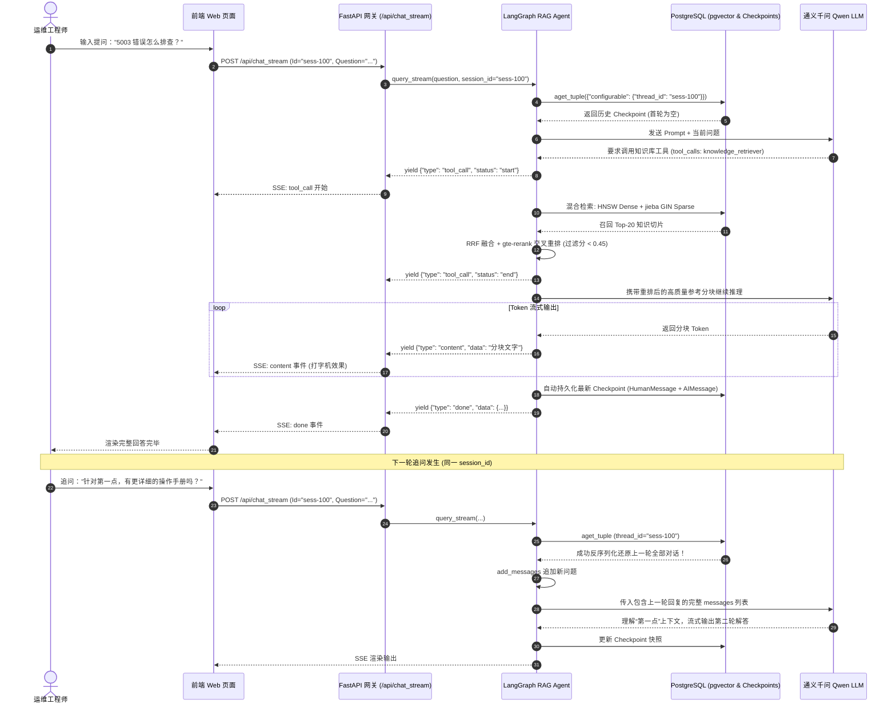
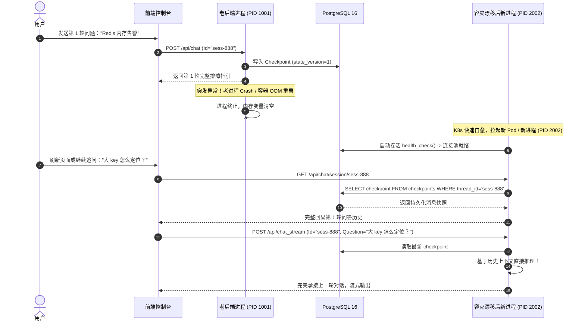

# SuperBizAgent 会话流转与前后端交互协议规范 (交互文档)

> **版本**：v1.0.0  
> **适用系统**：SuperBizAgent 智能 OnCall 运维排障系统  
> **文档定位**：前后端研发对接、LangGraph Agent 状态流转、会话持久化与断点续聊底层机制指南  
> **更新日期**：2026-11-04  

---

## 目录

1. [系统交互全景架构](#一系统交互全景架构)
2. [会话生命周期与上下文承接原理](#二会话生命周期与上下文承接原理)
   - [2.1 会话数据物理存储结构与 Checkpoint 机制](#21-会话数据物理存储结构与-checkpoint-机制)
   - [2.2 多轮追问与上下文检索核心原理解析](#22-多轮追问与上下文检索核心原理解析)
   - [2.3 消息实体标识字段与会话分割机制](#23-消息实体标识字段与会话分割机制)
   - [2.4 会话切换与跨进程断点续聊流程](#24-会话切换与跨进程断点续聊流程)
3. [HTTP RESTful API 交互规范](#三http-restful-api-交互规范)
   - [3.1 同步问答：POST /api/chat](#31-同步问答-post-apichat)
   - [3.2 流式问答：POST /api/chat_stream (SSE)](#32-流式问答-post-apichat_stream-sse)
   - [3.3 历史查询：GET /api/chat/session/{session_id}](#33-历史查询-get-apichatsessionsession_id)
   - [3.4 会话清空：POST /api/chat/clear](#34-会话清空-post-apichatclear)
   - [3.5 AIOps 诊断流：POST /api/aiops](#35-aiops-诊断流-post-apiaiops)
   - [3.6 健康检查：GET /health](#36-健康检查-get-health)
4. [SSE (Server-Sent Events) 事件流协议标准](#四sse-server-sent-events-事件流协议标准)
   - [4.1 数据帧基础规范](#41-数据帧基础规范)
   - [4.2 对话 Agent 事件类型清单](#42-对话-agent-事件类型清单)
   - [4.3 AIOps 诊断工作流事件类型清单](#43-aiops-诊断工作流事件类型清单)
5. [交互时序图 (Mermaid Sequence)](#五交互时序图-mermaid-sequence)
   - [5.1 多轮追问与工具调用交互时序](#51-多轮追问与工具调用交互时序)
   - [5.2 服务崩溃/网络闪断后断点恢复时序](#52-服务崩溃网络闪断后断点恢复时序)
6. [前端客户端集成代码示例 (TypeScript / JavaScript)](#六前端客户端集成代码示例-typescript--javascript)

---

## 一、系统交互全景架构

SuperBizAgent 采用前后端分离与事件驱动流式架构。客户端（Web 控制台/钉钉/企微运维机器人）通过 FastAPI 网关与后端 LangGraph Agent 通信，所有图状态和多轮消息历史统一由 PostgreSQL (`AsyncPostgresSaver`) 进行 ACID 持久化。

```mermaid
flowchart TD
    subgraph Frontend["前端展示层 (Web / 移动端 / 运维聊天群)"]
        UI["Web 控制台 (index.html)"]
        ChatInput["消息输入 / 追问框"]
        StreamParser["SSE 事件流解析器"]
    end

    subgraph Gateway["网关路由层 (FastAPI :9900)"]
        ChatRouter["/api/chat & /api/chat_stream"]
        SessionRouter["/api/chat/session/{id} & /chat/clear"]
        AIOpsRouter["/api/aiops"]
    end

    subgraph AgentCore["Agent 运行时与编排层 (LangGraph)"]
        RAGGraph["RAG 对话图 (rag_agent_service)"]
        AIOpsGraph["Plan-Execute-Replan 工作流 (aiops_service)"]
        Reducer["消息累加器 (add_messages Reducer)"]
    end

    subgraph Persistence["持久化与向量底座 (PostgreSQL 16)"]
        PGSaver["AsyncPostgresSaver 检查点管理器"]
        CPTable["public.checkpoints (状态快照主表)"]
        BlobTable["public.checkpoint_blobs (消息实体表)"]
        WriteTable["public.checkpoint_writes (WAL 写入表)"]
        Knowledge["rag.knowledge_chunks (知识库向量与倒排表)"]
    end

    subgraph External["外部模型与运维基础设施"]
        LLM["Qwen 大模型 (通义千问)"]
        DashScope["DashScope text-embedding-v4 / gte-rerank"]
        MCP["Prometheus / K8s / 日志 MCP 服务"]
    end

    UI --> ChatInput
    ChatInput -->|HTTP POST JSON (Id, Question)| ChatRouter
    ChatRouter -->|调用| RAGGraph
    RAGGraph -->|读取历史 Checkpoint| PGSaver
    PGSaver <-->|SQL 查询/恢复| CPTable
    PGSaver <-->|解序列化| BlobTable

    RAGGraph -->|检索知识库| Knowledge
    RAGGraph -->|上下文合并 (带历史)| LLM
    LLM -->|流式返回 Token / 工具调用| RAGGraph
    RAGGraph -->|追加新消息 (add_messages)| Reducer
    Reducer -->|状态保存| PGSaver
    RAGGraph -->|SSE EventStream| StreamParser
    StreamParser -->|渲染打字机动画/工具调用气泡| UI
```

---

## 二、会话生命周期与上下文承接原理

在很多开发者的直觉中，“每次 API 请求都是传一个新的 State”，那系统究竟是如何知道同一个会话上一轮的历史聊天记录？

### 2.1 会话数据物理存储结构与 Checkpoint 机制

LangGraph 会话持久化底层由 `AsyncPostgresSaver` 托管，在 PostgreSQL 中维护三张核心表：

| 表名 | 作用说明 | 核心字段 |
| :--- | :--- | :--- |
| `public.checkpoints` | 会话快照索引元数据 | `thread_id` (会话ID), `checkpoint_ns`, `checkpoint_id`, `parent_checkpoint_id`, `type`, `checkpoint` (JSON) |
| `public.checkpoint_blobs` | 序列化数据实体大对象 | `thread_id`, `checkpoint_ns`, `channel` (如 `messages`), `version`, `type`, `blob` (二进制/JSON payload) |
| `public.checkpoint_writes` | 节点流转的 WAL 事务记录 | `thread_id`, `checkpoint_ns`, `checkpoint_id`, `task_id`, `idx`, `channel`, `type`, `blob` |

#### 数据存储形式：
1. **存哪些数据**：
   - 会话中产生的全部对话消息序列：包括 `HumanMessage`、`AIMessage` 以及模型触发的 `ToolMessage`（包含工具调用入参和执行输出）。
   - 图执行节点游标：记录执行到了哪个 Node（如 `agent` 或 `tools`），方便断点继续执行。
   - 运行时元数据：`run_id`、时间戳、模型消耗的 `usage_metadata`（Token 计数）。
2. **如何读取**：
   - 每次请求进入时，根据请求头/请求体中的 `thread_id`（即前端传递的 `Id` 或 `session_id`），执行：
     ```python
     config = {"configurable": {"thread_id": session_id}}
     checkpoint_tuple = await checkpointer.aget_tuple(config)
     ```
   - `AsyncPostgresSaver` 从 `checkpoint_blobs` 和 `checkpoints` 中通过反序列化，还原出该会话最新的全量内存状态字典 `{"messages": [...]}`。

---

### 2.2 多轮追问与上下文检索核心原理解析

#### 核心场景模拟：
- **第 1 轮**：用户提问：“线上支付服务 CPU 告警怎么排查？”
- **模型回复**：列出了排查步骤（1. top 命令抓高负载线程；2. jstack 导出堆栈；3. 查看 gc 日志）。
- **第 2 轮追问**：用户发送疑问：“第 2 步导出的堆栈文件很大怎么看？”

#### 运作流程与底层揭秘：

```
[前端发起追问: Question="第 2 步导出的堆栈文件很大怎么看？", Id="session-001"]
        │
        ▼
1. FastAPI 接收请求，将 session_id 包装入 LangGraph 执行配置：
   config = {"configurable": {"thread_id": "session-001"}}
        │
        ▼
2. LangGraph 状态恢复阶段 (State Restoration)：
   Agent 图启动时，首先自动访问 PostgreSQL，以 thread_id="session-001" 为主键
   提取出历史最新快照：
   State.messages = [
       HumanMessage(content="线上支付服务 CPU 告警怎么排查？"),
       AIMessage(content="排查步骤：1. top... 2. jstack 导出堆栈... 3. gc...")
   ]
        │
        ▼
3. 状态合并阶段 (add_messages Reducer)：
   用户传入的新提问被封装为 HumanMessage("第 2 步导出的堆栈文件很大怎么看？")。
   LangGraph 的 State 定义使用 Annotated[Sequence[BaseMessage], add_messages]：
   新消息不是覆盖原有列表，而是通过 Reducer 函数追加到尾部！
   当前执行时内存中的 messages 变为 3 条：
   [HumanMessage(第1轮), AIMessage(第1轮), HumanMessage(第2轮追问)]
        │
        ▼
4. 大模型上下文组装与推理：
   Agent 将这 3 条消息作为完整历史送入通义千问 Qwen 大模型。
   大模型阅读全文，明确知道代词“第 2 步”指代上一轮的“jstack 导出的 Java 堆栈”，
   因此精准给出针对大堆栈文件使用 fastthread 分析或 awk 过滤的解决方案。
        │
        ▼
5. 自动 Checkpoint 写回持久化：
   大模型生成 AIMessage(第2轮回复)。
   LangGraph 自动将最新的完整状态原子事务写入 PostgreSQL 的 checkpoints 与 blobs 表。
   会话指针向前递增，为第 3 轮追问做好持久化准备。
```

---

### 2.3 消息实体标识字段与会话分割机制

在会话存储中，系统是靠什么区分提问、回复与工具调用的？是不是简单靠分隔符切分？

**答案：不是靠文本分隔符，而是严格依赖面向对象的强类型消息结构体与唯一标识字段。**

每条消息在反序列化后都是 `langchain_core.messages.BaseMessage` 的派生类实例：

```json
{
  "id": "e8a93cb1-2c5d-4f1b-a9f4-8246bc6c584b",
  "type": "human",
  "content": "线上支付服务 CPU 告警怎么排查？",
  "name": null,
  "additional_kwargs": {},
  "response_metadata": {}
}
```

```json
{
  "id": "run-b02446f2-3907-4e67-9c99-1dd8d10b7194",
  "type": "ai",
  "content": "",
  "tool_calls": [
    {
      "name": "knowledge_retriever",
      "args": {"query": "支付服务 CPU 告警 排查步骤"},
      "id": "call_9b1525a8-4bb0-43ea-9c09-64db9f2b87f9"
    }
  ],
  "response_metadata": {
    "finish_reason": "tool_calls",
    "model_name": "qwen-max"
  }
}
```

```json
{
  "id": "78a0d4c1-3f1a-4d43-8ff5-58019a79de5b",
  "type": "tool",
  "name": "knowledge_retriever",
  "tool_call_id": "call_9b1525a8-4bb0-43ea-9c09-64db9f2b87f9",
  "content": "{\"status\": \"success\", \"chunks\": [\"知识库分块内容...\"]}"
}
```

#### 关键标识字段列表：
- `id` (UUID 字符串)：每条消息的全局唯一 ID。如果在 Reducer 中传入了相同 `id` 的消息，系统会执行覆盖（更新），否则追加。
- `type` (枚举角色类型)：
  - `human`: 用户终端输入的原始提问。
  - `ai`: 大模型给出的回复或发起的工具调用指令。
  - `tool`: 工具执行完成后返回给模型的执行结果（包含 `tool_call_id` 用于与 AI 的调用发起精确配对）。
  - `system`: 预置的角色设定与安全规则 Prompt。
- `tool_calls` 与 `tool_call_id`：模型调用外部知识库检索工具或 MCP 诊断工具的链条闭环标识，确保复杂多轮 ReAct 工具调用不串线。

---

### 2.4 会话切换与跨进程断点续聊流程

1. **会话切换**：
   - 前端维护多个会话 Tab（如 `session_id = "session_cpu_01"` 与 `session_id = "session_mem_02"`）。
   - 切换会话时，前端直接向 `/api/chat/session/{session_id}` 发起 GET 请求拉取该会话的消息历史；后续发送消息时带上新的 `Id` 即可。
   - 两个会话在 PostgreSQL 中完全以 `thread_id` 区分隔离，互不干扰，零串话风险。
2. **跨进程 / 重启恢复**：
   - 即使后端容器发生故障 Crash 重启或进行灰度发布，由于会话已经刷入 PostgreSQL，新容器启动后，用户再次输入追问，新进程立刻通过 `aget_tuple` 无缝载入上一次对话状态，实现 100% 真实无损续聊。

---

## 三、HTTP RESTful API 交互规范

基础访问地址：`http://{host}:{port}`（默认 `http://0.0.0.0:9900`）  
数据交换格式：`application/json` 与 `text/event-stream`

### 3.1 同步问答：`POST /api/chat`

用于无流式诉求的简单调用（如内部告警网关自动问答）。

#### 请求参数：
- **Content-Type**: `application/json`
- **Body**:
  | 字段名 | 类型 | 必填 | 说明 | 示例 |
  | :--- | :--- | :--- | :--- | :--- |
  | `Id` | string | 是 | 唯一会话标识符 (UUID 或自定义业务 ID) | `"session_1730700000"` |
  | `Question` | string | 是 | 用户提问内容 | `"5003 错误码排查思路"` |

```json
{
  "Id": "session_1730700000",
  "Question": "5003 错误码排查思路"
}
```

#### 响应格式：
- **Status Code**: `200 OK`
- **Body**:
```json
{
  "code": 200,
  "message": "success",
  "data": {
    "success": true,
    "answer": "根据知识库排查指南，5003 错误码通常表示微服务链路超时...",
    "errorMessage": null
  }
}
```

---

### 3.2 流式问答：`POST /api/chat_stream` (SSE)

生产 Web UI 核心交互接口，通过 Server-Sent Events 流式下发思考、工具调用与内容 Token。

#### 请求参数：
- **Content-Type**: `application/json`
- **Body**:
```json
{
  "Id": "session_1730700000",
  "Question": "为什么支付服务出现 5003 告警？"
}
```

#### 响应格式：
- **Status Code**: `200 OK`
- **Content-Type**: `text/event-stream`
- **Cache-Control**: `no-cache`
- **Connection**: `keep-alive`

#### 流式响应数据流（示例片段）：
```text
event: message
data: {"type":"tool_call","data":{"tool":"knowledge_retriever","status":"start","input":{"query":"支付服务 5003 告警"}}}

event: message
data: {"type":"search_results","data":{"count":2,"results":[{"source":"aiops-docs/error_codes.md","score":0.89}]}}

event: message
data: {"type":"tool_call","data":{"tool":"knowledge_retriever","status":"end","output":"已检索到 5003 错误码处理手册"}}

event: message
data: {"type":"content","data":"针对"}

event: message
data: {"type":"content","data":"支付服务的"}

event: message
data: {"type":"content","data":" 5003 告警，"}

event: message
data: {"type":"content","data":"主要原因是下游依赖响应超时。"}

event: message
data: {"type":"done","data":{"answer":"针对支付服务的 5003 告警，主要原因是下游依赖响应超时。","tool_calls":[{"tool":"knowledge_retriever"}]}}
```

---

### 3.3 历史查询：`GET /api/chat/session/{session_id}`

用于前端进入会话或刷新页面时，还原过往聊天记录。

#### 请求参数：
- **路径参数**：`session_id` (string，必填)

#### 响应格式：
- **Status Code**: `200 OK`
- **Body**:
```json
{
  "session_id": "session_1730700000",
  "message_count": 4,
  "history": [
    {
      "role": "human",
      "content": "线上 CPU 飙高排查"
    },
    {
      "role": "assistant",
      "content": "排查建议第一步查看 top 输出..."
    },
    {
      "role": "human",
      "content": "第二步怎么做？"
    },
    {
      "role": "assistant",
      "content": "第二步通过 jstack 导出线程堆栈..."
    }
  ]
}
```

---

### 3.4 会话清空：`POST /api/chat/clear`

用于用户点击“新建对话”或“清除上下文”时，在数据库中物理/逻辑清空该 `session_id` 的记录。

#### 请求参数：
```json
{
  "sessionId": "session_1730700000"
}
```

#### 响应格式：
```json
{
  "status": "success",
  "message": "会话已清空",
  "data": null
}
```

---

### 3.5 AIOps 诊断流：`POST /api/aiops`

用于触发自主排障工作流（Plan-Execute-Replan），执行 Prometheus 指标拉取、K8s Pod 检查、日志诊断。

#### 请求参数：
```json
{
  "alert_id": "ALT-20261104-001",
  "service_name": "pay-gateway",
  "environment": "production"
}
```

#### 响应格式 (SSE)：
```text
event: message
data: {"type":"status","stage":"fetching_alerts","message":"正在从告警网关拉取最新活跃告警..."}

event: message
data: {"type":"plan","stage":"plan_created","message":"诊断计划制定完毕，共 4 个排查步骤","plan":["1. 检查网关 CPU/内存监控","2. 查询 Pod 运行状态与重启次数","3. 检索错误日志中的超时堆栈","4. 生成根因分析与自愈建议"]}

event: message
data: {"type":"step_complete","stage":"step_executed","current_step":"1. 检查网关 CPU/内存监控","result_preview":"CPU 使用率 88%，内存正常","remaining_steps":3}

event: message
data: {"type":"report","stage":"finished","report":"# 故障诊断报告\n**根因**：上游秒杀突发流量导致线程池打满。"}
```

---

### 3.6 健康检查：`GET /health`

生产 K8s Liveness & Readiness 探针及运维监控检查接口。已深度集成 PostgreSQL 连接池健康检查。

#### 响应格式 (数据库正常)：
- **Status Code**: `200 OK`
```json
{
  "status": "healthy",
  "service": "super-biz-agent-py",
  "version": "1.0.0"
}
```

#### 响应格式 (数据库故障/断开)：
- **Status Code**: `503 Service Unavailable`
```json
{
  "status": "unhealthy",
  "service": "super-biz-agent-py",
  "version": "1.0.0",
  "detail": "Database connection pool is down"
}
```

---

## 四、SSE (Server-Sent Events) 事件流协议标准

### 4.1 数据帧基础规范

1. 每条消息必须以 `event: message\n` 开头。
2. 数据体以 `data: <JSON_STRING>\n\n` 结尾（必须有两个换行符 `\n\n` 作为消息结束标志）。
3. 所有 `data` 均保证为严格合法 JSON 字符串，包含 `type` 和 `data`（或 `message`/`stage`）。

### 4.2 对话 Agent 事件类型清单

| `type` 字段 | 含义 | 前端建议处理方式 |
| :--- | :--- | :--- |
| `debug` | 状态机流转内部调试信息 | 忽略或在开发模式下输出至控制台 |
| `tool_call` | 工具开始或结束执行 | 在气泡上方渲染“🔍 正在检索知识库...”或状态标签 |
| `search_results` | 混合检索召回的文档切片 | 可在详情抽屉中展示命中切片及相似度得分 |
| `content` | 增量生成的回答 Token | 追加至当前回复气泡，执行打字机动态平滑渲染 |
| `done` | 对话完整结束标志 | 结束加载动画，解除输入框禁用状态，持久化完整答案 |
| `error` | 运行时抛出的业务或系统异常 | 弹窗 Toast 报错，并在气泡内渲染红色错误警告 |

---

## 五、交互时序图 (Mermaid Sequence)

### 5.1 多轮追问与工具调用交互时序



---

### 5.2 服务崩溃/网络闪断后断点恢复时序



---

## 六、前端客户端集成代码示例 (TypeScript / JavaScript)

在前端应用中，使用原生的 `fetch` 结合 `ReadableStream` 即可轻量级消费 SSE 流并实现多轮会话状态管理：

```typescript
// chat_client.ts
export interface ChatMessage {
  role: 'human' | 'assistant' | 'tool';
  content: string;
}

export class SuperBizChatClient {
  private baseUrl: string;
  private sessionId: string;

  constructor(baseUrl: string = 'http://localhost:9900', sessionId?: string) {
    this.baseUrl = baseUrl;
    // 若未传入 session_id，则前端生成随机 UUID 作为本轮会话标识
    this.sessionId = sessionId || `session_${Date.now()}_${Math.random().toString(36).substring(2, 9)}`;
  }

  public getSessionId(): string {
    return this.sessionId;
  }

  /**
   * 拉取当前会话的历史聊天记录 (刷新页面或切换会话时调用)
   */
  async loadHistory(): Promise<ChatMessage[]> {
    const res = await fetch(`${this.baseUrl}/api/chat/session/${this.sessionId}`);
    if (!res.ok) throw new Error(`拉取历史失败: ${res.statusText}`);
    const data = await res.json();
    return data.history;
  }

  /**
   * 清空当前会话在后端的上下文记录
   */
  async clearSession(): Promise<boolean> {
    const res = await fetch(`${this.baseUrl}/api/chat/clear`, {
      method: 'POST',
      headers: { 'Content-Type': 'application/json' },
      body: JSON.stringify({ sessionId: this.sessionId })
    });
    return res.ok;
  }

  /**
   * 发起流式多轮对话
   * @param question 用户的提问或追问
   * @param callbacks 状态回调函数
   */
  async sendMessageStream(
    question: string,
    callbacks: {
      onToken?: (textChunk: string) => void;
      onToolStatus?: (status: { tool: string; status: 'start' | 'end'; input?: any }) => void;
      onComplete?: (fullAnswer: string) => void;
      onError?: (error: string) => void;
    }
  ): Promise<void> {
    try {
      const response = await fetch(`${this.baseUrl}/api/chat_stream`, {
        method: 'POST',
        headers: { 'Content-Type': 'application/json' },
        body: JSON.stringify({
          Id: this.sessionId, // 保证多轮追问使用同一个 session_id
          Question: question
        })
      });

      if (!response.ok || !response.body) {
        throw new Error(`HTTP 异常: ${response.status} ${response.statusText}`);
      }

      const reader = response.body.getReader();
      const decoder = new TextDecoder('utf-8');
      let buffer = '';

      while (true) {
        const { done, value } = await reader.read();
        if (done) break;

        buffer += decoder.decode(value, { stream: true });
        const lines = buffer.split('\n\n');
        buffer = lines.pop() || ''; // 保持尾部未完成的 chunk

        for (const block of lines) {
          const trimmed = block.trim();
          if (!trimmed) continue;

          for (const line of trimmed.split('\n')) {
            if (line.startsWith('data: ')) {
              const rawData = line.substring(6).trim();
              try {
                const eventPayload = JSON.parse(rawData);
                this.handleEventPayload(eventPayload, callbacks);
              } catch (e) {
                console.warn('解析 SSE JSON 帧异常:', rawData);
              }
            }
          }
        }
      }
    } catch (err: any) {
      if (callbacks.onError) callbacks.onError(err.message || String(err));
    }
  }

  private handleEventPayload(
    payload: { type: string; data?: any },
    callbacks: any
  ) {
    switch (payload.type) {
      case 'tool_call':
        if (callbacks.onToolStatus) callbacks.onToolStatus(payload.data);
        break;
      case 'content':
        if (callbacks.onToken) callbacks.onToken(payload.data);
        break;
      case 'done':
        if (callbacks.onComplete) callbacks.onComplete(payload.data?.answer || '');
        break;
      case 'error':
        if (callbacks.onError) callbacks.onError(String(payload.data));
        break;
      default:
        // 调试消息或其他业务消息
        break;
    }
  }
}
```

---

## 七、交互质量保障与常见排错指南

1. **为什么连续提问有时没带上前文？**
   - 检查前端发送请求时 `Id`（或 `session_id`）是否在两次提问间发生了改变（如意外重新生成了随机 UUID）。只要保持 `Id` 一致，PostgreSQL 会自动恢复历史状态。
2. **为什么清空会话后还能查到旧消息？**
   - 调用 `/api/chat/clear` 时传递的 JSON 键为 `sessionId`（注意驼峰）。如果键名拼写错误会导致解析为 null 从而清空失败。请参考本规范 3.4 节定义。
3. **SSE 流式断开后重连处理：**
   - 生产环境中如果遇到网络闪断（如移动端弱网），前端捕获到 Fetch 网络错误后，无需担心服务端状态损坏。服务端在每一步执行完成均已原子刷盘；前端只需调用 `/api/chat/session/{session_id}` 获取已持久化的最新消息，即可无缝对齐本地与服务端状态。

---
> 💡 如需对系统架构与技术重构细节进行深入了解，请参阅同目录下的 [交接文档: 架构重构与混合检索交付总结](file:///root/go-study/super_oncall_agent/docs/01_交接文档_架构重构与混合检索交付总结.md)。

