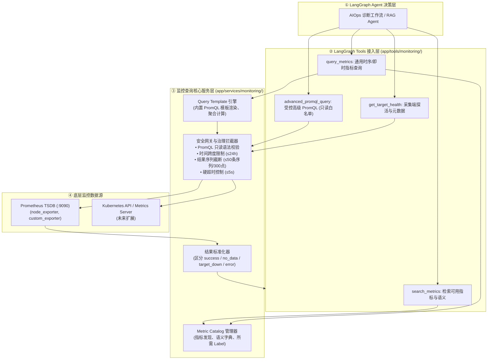
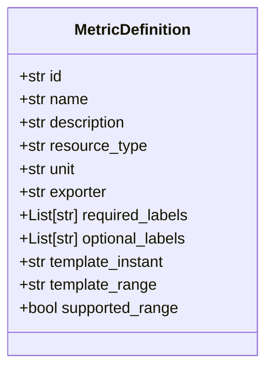

# SuperBizAgent 通用监控工具改造实施计划 (Metric Catalog + Query Templates)

> **版本**：v1.0.0  
> **定位**：AIOps 监控数据采集层专项改造方案  
> **指导思想**：**“Agent 决定查什么，监控服务保障怎么查”**。拒绝“每个指标一个 Tool”，也拒绝“完全无约束开放 PromQL”，建立基于**指标目录 (Metric Catalog)**与**查询模板 (Query Templates)**的受控通用监控体系。

---

## 一、系统全景架构设计

为了实现“先本地 Tool，未来无缝加 MCP 适配器”以及“数据层与 Agent 解耦”，监控工具采用四层分层架构：



---

## 二、三层查询模型与 Tool 详细规范

### 1. 第一层：指标目录与发现 (`search_metrics`) [P0]
Agent 在查询具体指标前，必须明确系统内支持哪些指标，防止胡乱猜测指标名。

* **工具名**：`search_metrics`
* **函数入参**：
  * `keyword` (str, 必填)：搜索关键词，支持中文或英文（如 `"CPU"`、`"内存"`、`"磁盘"`、`"network"`、`"load"`）。
  * `resource_type` (Optional[str])：资源类型过滤（`"node"`、`"container"`、`"app"`、`"all"`，默认 `"all"`）。
* **返回内容**：匹配到的指标元数据列表（逻辑 `metric_id`、中文名称、描述、单位、必需的 labels、是否支持区间时序）。

### 2. 第二层：受控通用查询 (`query_metrics`) [P0]
核心生产工具。通过“逻辑指标 ID + 查询模板”将 Agent 参数安全转化为正确的 PromQL。

* **工具名**：`query_metrics`
* **函数入参**：
  * `metric_id` (str, 必填)：指标目录中的逻辑 ID（如 `"node.cpu.usage"`、`"node.memory.used"`）。
  * `resource` (str, 必填)：资源类别（如 `"node"`）。
  * `filters` (Dict[str, str], 选填)：标签过滤条件（如 `{"instance": "rocky-linux-local"}`）。
  * `time_range` (str, 选填，默认 `"30m"`)：时间跨度（支持 `"5m"`, `"15m"`, `"1h"`, `"6h"`, `"24h"`）。
  * `query_mode` (str, 选填，默认 `"range"`)：
    * `"instant"`：返回当前最新的瞬时单值（适合快速探活与阈值判断）。
    * `"range"`：返回时间区间内的时序点列表与统计值（适合观察走势、突刺与均值）。
  * `step` (str, 选填，默认 `"1m"`)：采样步长（如 `"15s"`, `"1m"`, `"5m"`）。
* **执行逻辑**：
  1. 根据 `metric_id` 命中对应的模板（如 `100 - (avg by (instance) (rate(node_cpu_seconds_total{mode="idle"}[{rate_interval}])) * 100)`）。
  2. 注入 `filters` 标签和时间窗口，组装为合法 PromQL。
  3. 执行查询并计算聚合统计值（`avg`, `max`, `min`, `latest`, `p95`）。

### 3. 第三层：采集端探活与元数据 (`get_target_health`) [P0]
用于区分“指标值为 0 / 无数据”是业务正常还是底层 Exporter 挂了。

* **工具名**：`get_target_health`
* **函数入参**：
  * `job` (Optional[str])：采集 Job 名称（如 `"node_exporter"`, `"custom_exporter"`）。
  * `instance` (Optional[str])：实例地址（如 `"rocky-linux-local"`, `"127.0.0.1:9100"`）。
* **返回内容**：
  * 当前已配置的 Target 列表、存活状态（`UP` 或 `DOWN`）、最后采集时间戳、最后错误信息 (`lastError`)。

### 4. 第四层：受控高级 PromQL 查询 (`advanced_promql_query`) [P2]
为复杂多指标关联场景保留的高级能力（严格受控）。

* **工具名**：`advanced_promql_query`
* **安全策略**：
  * 纯只读 PromQL 语法校验，拒绝任何带子命令或写意图的请求。
  * 强制注入时间范围上限（最大不得超过 24 小时）。
  * 强制限制返回时序条数不超过 50 条，每个时序数据点不超过 300 个。

---

## 三、指标目录 (Metric Catalog) 覆盖清单 (第一批 20+ 个指标)

目录保存在 `app/services/monitoring/catalog_definitions.py`（支持从 YAML 动态扩充）：



| 逻辑 ID (`metric_id`) | 中文名称 | 数据源 Exporter | 单位 | 核心 PromQL 计算模板 |
| :--- | :--- | :--- | :--- | :--- |
| `node.cpu.usage` | 主机 CPU 使用率 | node_exporter | `%` | `100 - (avg by (instance) (rate(node_cpu_seconds_total{mode="idle", {labels}}[1m])) * 100)` |
| `node.cpu.load1` | 1 分钟平均负载 | node_exporter | 数值 | `node_load1{{labels}}` |
| `node.cpu.load5` | 5 分钟平均负载 | node_exporter | 数值 | `node_load5{{labels}}` |
| `node.cpu.load15` | 15 分钟平均负载 | node_exporter | 数值 | `node_load15{{labels}}` |
| `node.memory.usage` | 主机内存使用率 | node_exporter | `%` | `(1 - (node_memory_MemAvailable_bytes{{labels}} / node_memory_MemTotal_bytes{{labels}})) * 100` |
| `node.memory.used` | 已用物理内存 | node_exporter | Bytes | `node_memory_MemTotal_bytes{{labels}} - node_memory_MemAvailable_bytes{{labels}}` |
| `node.memory.total` | 物理内存总量 | node_exporter | Bytes | `node_memory_MemTotal_bytes{{labels}}` |
| `node.disk.usage` | 磁盘分区使用率 | node_exporter | `%` | `(1 - (node_filesystem_avail_bytes{fstype!~"tmpfs|overlay", {labels}} / node_filesystem_size_bytes{fstype!~"tmpfs|overlay", {labels}})) * 100` |
| `node.disk.io_read_rate` | 磁盘读速率 | node_exporter | Bytes/s | `sum by (instance) (rate(node_disk_read_bytes_total{{labels}}[1m]))` |
| `node.disk.io_write_rate` | 磁盘写速率 | node_exporter | Bytes/s | `sum by (instance) (rate(node_disk_written_bytes_total{{labels}}[1m]))` |
| `node.net.receive_rate` | 网卡入网带宽 | node_exporter | Bytes/s | `sum by (instance) (rate(node_network_receive_bytes_total{device!~"lo|docker.*|br.*", {labels}}[1m]))` |
| `node.net.transmit_rate` | 网卡出网带宽 | node_exporter | Bytes/s | `sum by (instance) (rate(node_network_transmit_bytes_total{device!~"lo|docker.*|br.*", {labels}}[1m]))` |
| `node.net.drop_errors` | 网络丢包错误率 | node_exporter | 次数/s | `sum by (instance) (rate(node_network_receive_errs_total{{labels}}[1m]))` |
| `app.process.cpu_usage` | 进程 CPU 消耗 | custom / process | `%` | `rate(process_cpu_seconds_total{{labels}}[1m]) * 100` |
| `app.process.memory_rss` | 进程常驻物理内存 | custom / process | Bytes | `process_resident_memory_bytes{{labels}}` |
| `app.process.open_fds` | 进程打开句柄数 | custom / process | 个 | `process_open_fds{{labels}}` |
| `app.runtime.goroutines` | Go 协程数量 | custom / go runtime | 个 | `go_goroutines{{labels}}` |
| `app.runtime.gc_duration_p99`| GC 暂停耗时 P99 | custom / go runtime | 秒 | `go_gc_duration_seconds{{labels}}` |
| `exporter.target.up` | Exporter 探活状态 | prometheus | 布尔 (1/0) | `up{{labels}}` |

---

## 四、标准化结果协议 (Standardized Response Contract)

工具统一返回标准的 JSON 结构，绝不以空充好：

```json
{
  "status": "success",
  "source": "prometheus",
  "metric_id": "node.cpu.usage",
  "metric_name": "主机 CPU 使用率",
  "resource": "node",
  "unit": "%",
  "query_mode": "range",
  "query_window": {
    "start": "2026-11-05T11:20:00Z",
    "end": "2026-11-05T11:50:00Z",
    "step": "1m"
  },
  "is_stale": false,
  "summary": {
    "latest": 87.56,
    "avg": 82.14,
    "max": 93.80,
    "min": 74.20,
    "p95": 91.50
  },
  "series_count": 1,
  "data_preview": [
    {"timestamp": "11:20", "value": 78.2},
    {"timestamp": "11:25", "value": 85.4},
    {"timestamp": "11:30", "value": 87.56}
  ],
  "message": "查询成功，共召回 1 条时序，30 个时序采样点"
}
```

当查询不到数据或服务异常时：

```json
{
  "status": "no_data",
  "source": "prometheus",
  "metric_id": "node.cpu.usage",
  "reason": "no_matching_series",
  "diagnostic_hint": "在 Prometheus 中未找到匹配标签 {instance='unknown'} 的时序，建议调用 get_target_health 检查采集目标",
  "data": []
}
```

---

## 五、项目工程目录规划

```text
app/
├── services/
│   └── monitoring/
│       ├── __init__.py
│       ├── client.py             # Prometheus 异步 HTTP 客户端与超时连接池
│       ├── catalog.py            # Metric Catalog 管理器 (加载、检索、校验)
│       ├── catalog_definitions.py# 指标目录与 PromQL 模板库
│       ├── gateway.py            # 安全网关 (只读语法树校验、时间窗口与序列截断)
│       └── formatter.py          # 标准化结果封装与聚合计算器 (avg, p95)
└── tools/
    ├── __init__.py
    ├── knowledge_tool.py         # 已有的知识库检索工具
    ├── time_tool.py              # 已有的时间工具
    └── monitoring_tools.py       # 新增：通用监控工具 (search_metrics, query_metrics, get_target_health)
```

---

## 六、实施计划路线图 (8 步里程碑)

| 步骤 | 里程碑任务 | 交付目标 | 验收标准 | 状态 |
| :---: | :--- | :--- | :--- | :---: |
| **01** | **梳理当前 Prometheus 存量指标** | 提取本地 `127.0.0.1:9090` 348 个指标的 Label 字典与活跃 Target | 输出实际可查的指标和 Target 拓扑 | ⬜ 待开始 |
| **02** | **建立 Metric Catalog 与模板库** | 编写 `catalog_definitions.py`，收录首批 20+ 个核心指标元数据与模板 | 覆盖 Host CPU/内存/磁盘/网络、进程与 Go 运行时 | ⬜ 待开始 |
| **03** | **实现异步 Prometheus Client 与网关** | 封装带超时、重试、错误映射的异步客户端 `PrometheusClient` | 异步请求 `query`、`query_range`、`targets` 毫秒级返回 | ⬜ 待开始 |
| **04** | **实现 `search_metrics` 工具** | 支持模糊关键词、中文含义、资源类型过滤 | 输入 `"cpu"`、`"内存"` 可精准召回对应的逻辑 ID 与描述 | ⬜ 待开始 |
| **05** | **实现 `query_metrics` 工具** | 支持 `instant` 瞬时值和 `range` 时序区间，计算统计摘要 (avg/max/p95) | 真实拉取本机过去 30 分钟 CPU 走势 | ⬜ 待开始 |
| **06** | **实现 `get_target_health` 工具** | 直连 `/api/v1/targets` 探测 Exporter 存活性 | 准确发现 `rocky-linux-local` (UP) 和 `custom_exporter` (DOWN) | ⬜ 待开始 |
| **07** | **接入安全治理与结果标准化** | 限制时间 ≤24h、限制序列数 ≤50、规范化 `no_data` 与 `target_down` 错误码 | 异常输入不抛 500，给出诊断建议 | ⬜ 待开始 |
| **08** | **四个真实运维场景端到端测试** | 编写单元测试与场景验证脚本：<br/>1. CPU 飙高排查<br/>2. 内存压力检测<br/>3. 网络丢包探测<br/>4. Target 宕机/无数据自愈诊断 | 4 个场景测试全部 PASS，生成标准化证据 | ⬜ 待开始 |

---

## 七、下一步行动提议

1. **第 1 步启动**：如果您确认本实施计划无误，我们将首先在项目中建立 `app/services/monitoring/` 模块，编写 `catalog_definitions.py` 与 `client.py`。
2. **渐进式注册**：先将这 3 个 P0 工具注册到 `app/tools/monitoring_tools.py` 并通过单元测试验证，再平滑挂载到 LangGraph Agent 中。
