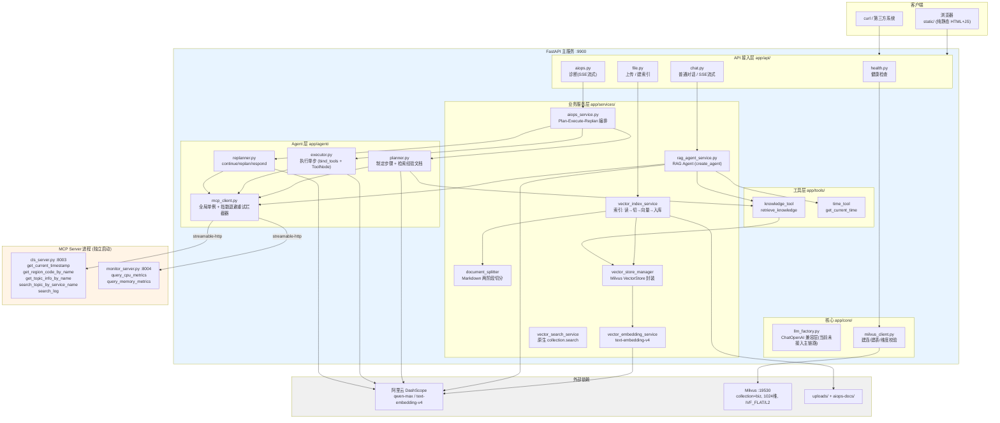
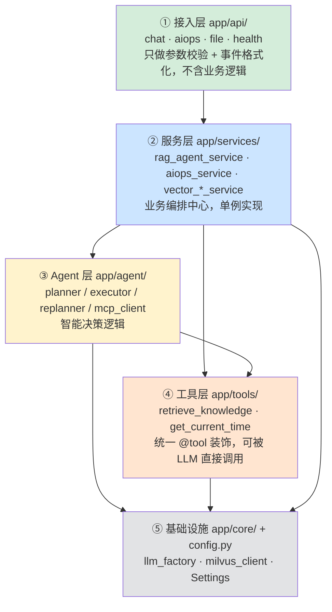
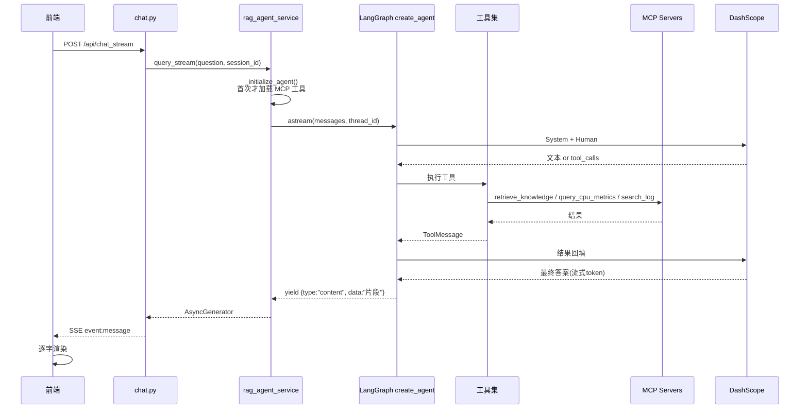
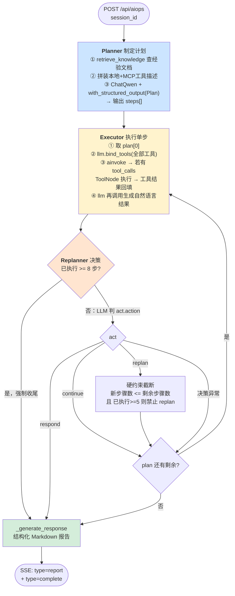
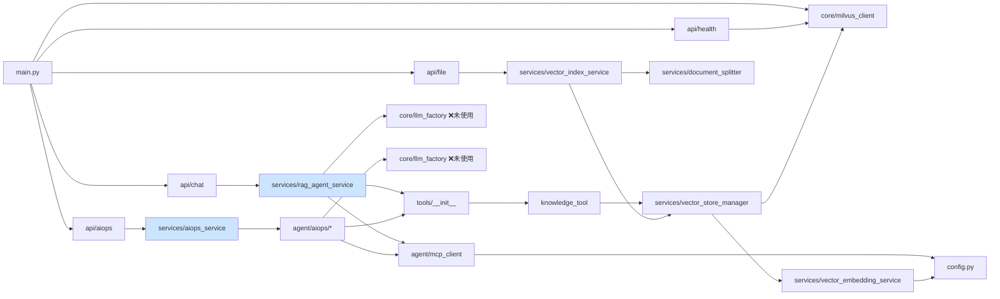
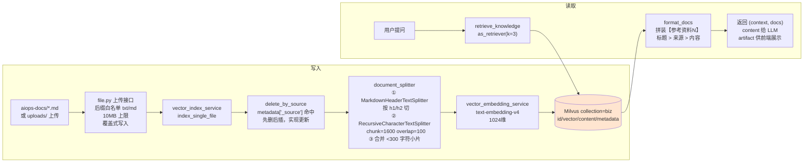

# SuperBizAgent 项目架构分析

> 分析对象：`super_biz_agent_py-release-2026-03-16`
> 代码规模：39 个 Python 文件 / 约 4642 行 + 静态前端 + 2 个 MCP Server

---

## 一、一句话概括

一个 **FastAPI 单体服务**，对外提供两条并行的智能链路：

1. **RAG 问答链路** —— 用户提问 → Agent 自主选工具（知识库 / 时间 / 监控 / 日志）→ 流式回答
2. **AIOps 诊断链路** —— 自动拉告警 → Plan-Execute-Replan 多步排查 → 生成 Markdown 诊断报告

工具能力通过 **MCP 协议**外接两个独立进程（CLS 日志、Monitor 监控），知识通过 **Milvus** 向量化存储，LLM 统一走 **阿里云 DashScope（通义千问）**。

---

## 二、整体架构图



---

## 三、分层结构图

代码严格按五层组织，**上层依赖下层，下层不知道上层**：



**横向切面**（贯穿所有层）：
- `app/models/` — Pydantic 请求/响应模型（3 类：Request / Response / Document+Aiops）
- `app/utils/logger.py` — Loguru 日志，`app/__init__.py` 自动加载

---

## 四、两条核心链路（时序图）

### 链路 A：RAG 问答



**关键点**
- 用 LangChain 官方预构建的 `create_agent`（ReAct 循环），**手写图的地方没有** —— 这条链路代码量最小
- 会话记忆 = `MemorySaver` checkpointer，`thread_id = session_id`，进程内内存，**重启即丢**
- Agent 首次调用时才 `_initialize_agent()` 加载 MCP 工具（懒加载），避免启动时 MCP 未就绪导致崩溃

### 链路 B：AIOps 诊断（手写 LangGraph）



**PlanExecuteState**（`app/agent/aiops/state.py`）只有 4 个字段：

| 字段 | 类型 | 更新语义 |
|---|---|---|
| `input` | `str` | 初始写入，任务描述 |
| `plan` | `List[str]` | 覆盖式，Executor 取 `plan[0]` 后 `plan[1:]` |
| `past_steps` | `Annotated[List[tuple], operator.add]` | **追加式**，保存 `(步骤, 结果)` |
| `response` | `str` | 非空 = 流程结束（`should_continue` 条件边判据） |

**防死循环设计**：Replanner 里有 4 层硬约束（`MAX_STEPS=8`、新步骤数截断、已执行≥5 禁 replan、prompt 里"优先结束"），因为这是无预算的 LLM 循环。

---

## 五、模块依赖关系



> ⚠️ 实际只有 **2 条 LLM 构造路径**：`ChatQwen`（`langchain_qwq`，实际生效）和 `ChatOpenAI`（`llm_factory.py`，定义了但**无任何地方 import**）。

---

## 六、工具生态全景

| 来源 | 工具 | 实现 | 说明 |
|---|---|---|---|
| 本地 | `retrieve_knowledge` | Milvus 向量检索，top_k=3 | `response_format="content_and_artifact"` |
| 本地 | `get_current_time` | `datetime` | 零成本 |
| MCP·CLS `:8003` | `get_current_timestamp` | 返回毫秒时间戳 | 供 `search_log` 计算时间窗 |
| | `get_region_code_by_name` | 模拟 | |
| | `get_topic_info_by_name` | 模拟 | |
| | `search_topic_by_service_name` | 模拟 | 定位日志主题 |
| | `search_log` | 模拟 | CLS 语法查询 |
| MCP·Monitor `:8004` | `query_cpu_metrics` | **随机数生成** | 10% 起步 → 指数上升至 96%，触发 80% 阈值 |
| | `query_memory_metrics` | **随机数生成** | 30% 起步 → 线性上升至 85%，阈值 70% |

**工具注入点**：`retrieve_knowledge + get_current_time + MCP 工具` 在 3 处（`rag_agent_service`、`planner`、`executor`）**重复拼装**，无统一入口。

**可靠性**：`mcp_client.py` 的 `retry_interceptor` 对所有 MCP 调用做 3 次指数退避（1s/2s/4s），全部失败时返回 `CallToolResult(isError=True)` 而非抛异常 —— 保证 Planner/Executor 的循环不被打断。

---

## 七、数据流：文档入库与检索



**Milvus Schema**（`core/milvus_client.py` 硬编码，维度不匹配时**自动删表重建**）：

| 字段 | 类型 | 说明 |
|---|---|---|
| `id` | VARCHAR(100) | 主键，`auto_id=False`，UUID v4 |
| `vector` | FLOAT_VECTOR(1024) | 索引 `IVF_FLAT` / `L2`，`nlist=128` |
| `content` | VARCHAR(8000) | 分片正文 |
| `metadata` | JSON | `_source` `_file_name` `h1` `h2` |

---

## 八、运行拓扑

```
进程 1: docker compose (vector-database.yml)
  ├─ milvus-etcd      v3.5.18
  ├─ milvus-minio     RELEASE.2023-03-20
  ├─ milvus-standalone v2.5.10  :19530
  └─ zilliz/attu      v2.5       :3000   (Web 控制台)

进程 2: python mcp_servers/cls_server.py        → 127.0.0.1:8003/mcp
进程 3: python mcp_servers/monitor_server.py    → 127.0.0.1:8004/mcp
进程 4: python -m uvicorn app.main:app         → 0.0.0.0:9900
        ├── /              静态首页
        ├── /docs          Swagger
        ├── /api/chat      对话
        ├── /api/chat_stream
        ├── /api/aiops     诊断
        ├── /api/upload    上传+建索引
        └── /api/health    健康检查
```

**启动顺序强依赖**：Milvus → MCP Servers → FastAPI。FastAPI 启动时 `lifespan` 同步 `milvus_manager.connect()`，连不上直接抛 `RuntimeError` 启动失败。

---

## 九、API 一览

| 方法 | 路径 | 层 | 返回 | 备注 |
|---|---|---|---|---|
| POST | `/api/chat` | chat | JSON | 一次性返回完整答案 |
| POST | `/api/chat_stream` | chat | SSE | 事件：`content` / `tool_call` / `search_results` / `done` / `error` / `debug` |
| POST | `/api/chat/clear` | chat | JSON | 删 checkpointer thread |
| GET | `/api/chat/session/{id}` | chat | JSON | 读会话历史 |
| POST | `/api/aiops` | aiops | SSE | 事件：`status`/`plan`/`step_complete`/`report`/`complete`/`error` |
| POST | `/api/upload` | file | JSON | 上传即建索引（索引失败不影响上传成功） |
| POST | `/api/index_directory` | file | JSON | 批量索引目录 |
| GET | `/api/health` | health | JSON | Milvus 不可用 → HTTP 503 |

---

## 十、架构层面的观察

> 只是客观记录，**不是问题清单**（后续可展开）。

| 观察点 | 现状 |
|---|---|
| 单体 + 全局单例 | 6 个模块级单例（`rag_agent_service` / `aiops_service` / `vector_store_manager` / `vector_index_service` / `document_splitter_service` / `milvus_manager`），隐式全局状态 |
| 记忆存储 | `MemorySaver` 纯内存，会话历史重启即丢；`get_session_history` 靠读 checkpoint 内部结构 `channel_values` 拿数据，**耦合 LangGraph 私有实现** |
| MCP 数据 | CLS / Monitor **全是 `random` 生成的模拟数据**，无真实对接；工具 docstring 里写死 `data-sync-service` 等示例 |
| 死代码 | `core/llm_factory.py`（ChatOpenAI）无引用；`services/vector_search_service.py`（原生 search）无引用（走的是 LangChain Milvus 封装） |
| 重复 | 工具拼装逻辑在 3 处重复；`ChatQwen(...)` 构造在 4 处重复 |
| 全局状态 | `vector_store_manager` 在 `__init__` 里连 Milvus，**import 阶段即建立连接**（比 FastAPI lifespan 更早） |
| CORS | `allow_origins=["*"]` + `allow_credentials=True`，生产不安全 |
| 无测试 | `pytest` 在 dev 依赖里，但仓库内无任何测试文件 |
| 步数上限 | Replanner `MAX_STEPS=8` 硬编码，与 prompt 里的"≥3 / ≥5"阈值、plan 里的步骤数约定**三处数字不一致** |

---

*下一次可以深入任意一块：RAG 检索质量 / AIOps 循环收敛性 / MCP 接入方式 / 部署与可观测性。*
